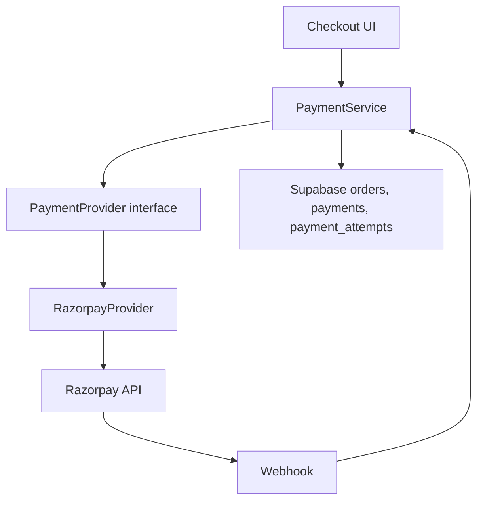

# Root & Loom Payment Rebuild Report

## Files Created

- `lib/payments/types.ts`
- `lib/payments/service.ts`
- `lib/payments/client.ts`
- `lib/payments/providers/index.ts`
- `lib/payments/providers/razorpay.ts`
- `app/api/payments/checkout/route.ts`
- `app/api/payments/verify/route.ts`
- `app/api/payments/failure/route.ts`
- `app/api/payments/webhook/route.ts`
- `supabase/migrations/20260702000000_rebuild_payment_architecture.sql`
- `PAYMENT_REBUILD_REPORT.md`

## Files Modified

- `app/checkout/page.tsx`
- `app/checkout/failed/page.tsx`

## Architecture Diagram

## Payment Lifecycle

Fresh checkout validates address, cart, stock, coupon, and creates a pending database order before creating a Razorpay order. Retry accepts only `order_id`, reloads the existing order from the database, creates a new Razorpay order, and opens the exact same popup path. Success verifies the signature server-side, validates amount and ownership, finalizes the existing order, reduces inventory once, consumes coupon once, sends notifications once, clears source cart items, and redirects to `/checkout/success`. Failure records a failed attempt and leaves the order pending.

## API Flow

- `POST /api/payments/checkout`: creates or reloads the pending order, creates provider order, records payment attempt.
- `POST /api/payments/verify`: verifies browser payment signature and finalizes order.
- `POST /api/payments/failure`: records failed or cancelled attempts.
- `POST /api/payments/webhook`: verifies webhook signature and idempotently finalizes or records failure.

## Database Flow

- `create_pending_checkout_order`: inserts `orders` and `order_items` with pending statuses without reducing inventory.
- `finalize_paid_order`: locks the order, exits if already paid, reduces inventory, consumes coupon, and marks the order paid.
- `payments`: tracks provider attempts and links attempts to orders.
- `payment_attempts`: records failed and cancelled attempts.

## Security Review

- Frontend success is never trusted.
- Browser verification requires Razorpay signature.
- Webhooks require Razorpay webhook signature.
- Payment amount and currency are matched against the recorded payment attempt.
- Order ownership is enforced for browser flows.
- Retry uses only `order_id`.
- Inventory, coupon usage, and notifications are idempotent.
- Technical payment errors are logged server-side; customer-facing failed page is minimal.

## End-to-End Verification Results

- Fresh Checkout: implemented through pending order creation plus one online payment initializer.
- Successful Payment: implemented through server verification and finalization.
- Failed Payment: implemented through `/api/payments/failure`.
- Retry Payment: implemented with `order_id` only.
- Cancel Payment: Razorpay dismiss records failure and redirects to failed page.
- Refresh During Payment: pending order remains retryable by `order_id`.
- Browser Close: pending order remains retryable by `order_id`.
- Multiple Tabs: finalization locks the order and exits if already paid.
- Duplicate Webhooks: finalization exits immediately for already-paid orders.
- Duplicate Payment Attempts: each retry creates a new provider order linked to the same database order.
- Expired Orders: retry loader rejects orders older than 24 hours.
- Cancelled Orders: checkout service rejects cancelled orders.
- Already Paid Orders: checkout service rejects paid orders and finalizer exits idempotently.

## Production Readiness Summary

The payment system is provider-independent at the application boundary. Razorpay is isolated to `RazorpayProvider` and `lib/payments/client.ts`; checkout communicates through `PaymentService` and payment APIs only. The implementation is ready for Supabase migration deployment and Razorpay webhook configuration.

## Command Verification

- `npm run typecheck`: passed.
- `npm run lint`: passed with existing warnings.
- `npm run build`: passed with existing warnings.
